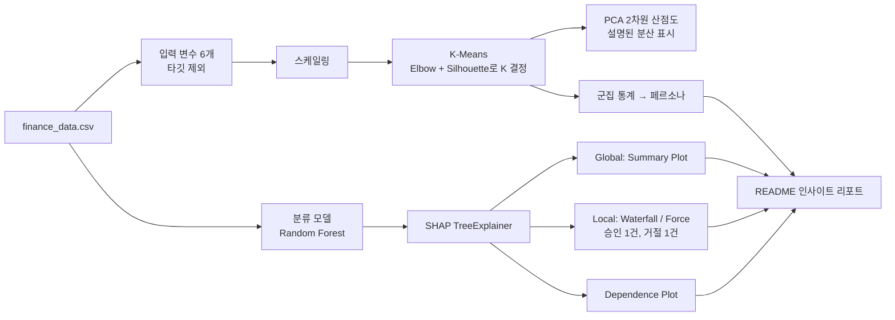
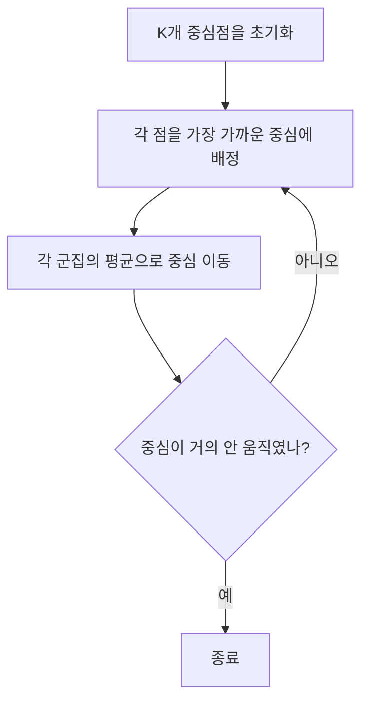
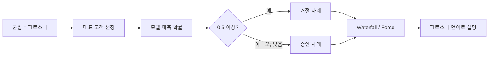

# A5-2 개념 정리 — 군집화, PCA, SHAP으로 "왜 그런 판정인가" 설명하기

대상: A5-1에서 지도학습 파이프라인을 만들어 봤지만 비지도 학습과 XAI는 처음인 학습자<br>
기준 과제: [A5-2 과제 원문(subject.md)](../subject.md)<br>
함께 볼 문서: [A5-2 단계별 실습 가이드(WALKTHROUGH.md)](WALKTHROUGH.md)

이 문서는 과제에 필요한 개념을 설명합니다. 코드를 어떤 순서로 작성하는지는 [WALKTHROUGH.md](WALKTHROUGH.md)에서 다룹니다. 개념마다 일상 비유 → 정확한 정의 → 손으로 계산하는 작은 예제 → 과제와의 연결 → 흔한 오해 순서로 설명합니다.

과제 원문의 "Mission 23"은 이 저장소 기준으로 바로 앞 과제인 A5-1(대출 심사 모델)을 가리킵니다. 같은 `finance_data.csv`와, A5-1에서 만든 분류 모델(Random Forest 등)을 이어서 사용합니다.

## 읽는 순서

| 순서 | 배울 내용 | 이걸 알면 할 수 있는 일 |
| --- | --- | --- |
| 1 | 지도학습과 비지도학습 | 왜 군집화에서 타깃 열을 빼야 하는지 설명하기 |
| 2 | 거리와 스케일링 | K-Means 전에 스케일링이 필수인 이유를 숫자로 보여 주기 |
| 3 | K-Means | 군집이 만들어지는 과정을 손으로 따라가기 |
| 4 | Elbow Method와 Silhouette Score | 최적의 K를 근거와 함께 고르기 |
| 5 | 군집 프로파일링과 페르소나 | 군집 통계를 "VIP", "주의군" 같은 고객 유형으로 번역하기 |
| 6 | PCA와 Explained Variance | 6차원 데이터를 2차원 산점도로 그리고 설명력 표시하기 |
| 7 | 설명 가능한 AI(XAI)의 큰 그림 | Global 해석과 Local 해석의 차이 구분하기 |
| 8 | Shapley 값 | 변수별 기여도를 손으로 계산해 보기 |
| 9 | SHAP 라이브러리와 TreeExplainer | Random Forest에 SHAP을 적용하고 출력 구조 이해하기 |
| 10 | SHAP 그래프 읽기 | Summary, Waterfall, Force, Dependence Plot 해석하기 |
| 11 | 승인/거절 사례 선정과 페르소나 연결 | 군집 대표 고객의 예측 근거 설명하기 |
| 12 | 비기술자에게 전달하기 | 그래프를 비즈니스 언어로 바꿔 리포트 쓰기 |
| 13 | 보너스: DBSCAN, 계층적 군집, Streamlit | 다른 군집 알고리즘과 대시보드 이해하기 |

1~6은 `analysis_clustering` 단계, 7~11은 `analysis_shap` 단계, 12는 README 작성 단계에 해당합니다. 과제가 정한 실행 순서(analysis_clustering → analysis_shap → README)와 같습니다.

## 0. 과제 전체 그림



과제의 이야기는 세 질문으로 요약됩니다.

1. **누구인가?** — 군집화로 고객 페르소나를 찾는다.
2. **어떻게 판정하나?** — 분류 모델로 연체 위험(거절/승인)을 예측한다.
3. **왜 그렇게 판정했나?** — SHAP으로 예측 근거를 설명한다.

## 1. 지도학습과 비지도학습

### 비유

- 지도학습: 선생님이 정답을 알려 주며 가르치는 수업. "이 고객은 연체했다/안 했다"가 붙은 데이터로 배웁니다.
- 비지도학습: 정답 없이 학생들 스스로 "취미가 비슷한 사람끼리" 모둠을 나누는 활동. 모둠에 이름표가 원래 붙어 있지 않습니다.

### 정의

**군집화(Clustering)** 는 정답 레이블 없이, 서로 비슷한 샘플끼리 묶는 비지도학습입니다. 여기서 "비슷하다"는 대부분 **거리가 가깝다**는 뜻입니다.

### 과제와의 연결

과제는 "군집화 분석 시에는 타깃 변수(신용 점수, 연체 여부)를 제외하고 입력 변수만 사용"하도록 요구합니다. 군집화에 쓰는 열은 다음 6개입니다.

`age`, `annual_income`, `spending_score`, `debt_ratio`, `credit_card_count`, `overdue_count_6m`

타깃을 넣으면 "연체한 사람 묶음"이 그대로 군집이 되어 버려서, 숨겨진 고객 유형을 찾는다는 목적에서 벗어납니다. 다만 군집을 만든 **뒤에** 각 군집의 연체율을 계산해 해석에 참고하는 것은 군집 형성에 타깃을 쓰는 것과 다릅니다. 이렇게 할 경우 README에 "군집 형성에는 사용하지 않고 사후 해석에만 사용했다"고 밝히는 것을 권장합니다.

### 데이터 사용 정책

| 구분 | 내용 |
| --- | --- |
| 허용 | 원본 CSV 기준 스케일링, 결측치 처리, 이상치 제거 등 전처리 |
| 금지 | 임의 컬럼 추가, 외부 데이터 병합, 데이터 증강 |

예를 들어 "소득 대비 카드 수" 같은 새 열을 만들어 군집화하면 금지 사항인 임의 컬럼 추가에 해당합니다. SMOTE처럼 가짜 샘플을 만드는 것도 데이터 증강에 해당하므로 이 과제에서는 쓰지 않습니다(SMOTE가 들어 있는 imbalanced-learn은 허용 라이브러리 목록에도 없습니다).

## 2. 거리와 스케일링

### 비유

두 도시 사이 거리를 "서울-부산 400km, 해발고도 차 0.1km"로 재면 고도는 사실상 무시됩니다. 단위가 큰 변수가 거리를 독차지하는 것입니다.

### 정의: 유클리드 거리

$$d(\mathbf{a}, \mathbf{b}) = \sqrt{\sum_{j=1}^{p} (a_j - b_j)^2}$$

### 손 계산: 스케일링 전과 후

세 고객이 있습니다(소득 단위 만원, 부채 비율 0~1).

| 고객 | 소득 | 부채 비율 |
| --- | --- | --- |
| A | 5000 | 0.2 |
| B | 5100 | 0.9 |
| C | 5900 | 0.2 |

**스케일링 전**

- $d(A,B) = \sqrt{100^2 + 0.7^2} \approx 100.0$
- $d(A,C) = \sqrt{900^2 + 0^2} = 900$

A와 가장 비슷한 사람은 B로 나옵니다. 그런데 B는 부채 비율이 0.9로 A와 재무 상황이 전혀 다릅니다. 소득 숫자가 커서 부채 비율 차이가 묻혔습니다.

**표준화 후** (소득 표준편차 약 2000, 부채 비율 표준편차 약 0.29로 나눔)

- A-B: 소득 차 $100/2000 = 0.05$, 부채 차 $0.7/0.29 \approx 2.41$ → $d \approx 2.41$
- A-C: 소득 차 $900/2000 = 0.45$, 부채 차 0 → $d = 0.45$

이제 A와 가장 비슷한 사람은 C입니다. 직관과 맞습니다.

### 과제와의 연결

과제는 "K-Means 적용 전 데이터 스케일링이 수행되어 있어야 한다"고 요구합니다. `StandardScaler`(평균 0, 표준편차 1)가 가장 일반적입니다. 공식은 $z = (x - \mu)/\sigma$이며 A5-1 개념 정리의 "5.2 스케일링"에서 다뤘습니다. 스케일러의 평균과 표준편차는 군집화에 쓰는 입력 변수로 fit합니다.

### 흔한 오해

- "스케일링하면 데이터가 바뀌니 해석이 틀어진다" — 스케일링은 군집을 **만들 때만** 씁니다. 군집별 특징을 설명할 때는 원래 단위(만원, 비율)의 값으로 평균을 내야 사람이 이해할 수 있습니다(5장).

## 3. K-Means

### 비유

운동장에 학생들이 흩어져 있고, 깃발 K개를 꽂습니다. 학생은 가장 가까운 깃발로 모이고, 깃발은 모인 학생들의 한가운데로 옮겨집니다. 이걸 깃발이 더 이상 움직이지 않을 때까지 반복합니다.

### 알고리즘



목표는 **Inertia**(군집 내 제곱합, WCSS)를 최소화하는 것입니다.

$$\text{Inertia} = \sum_{k=1}^{K} \sum_{x_i \in C_k} \lVert x_i - \mu_k \rVert^2$$

$\mu_k$는 군집 $k$의 중심입니다. 값이 작을수록 군집이 촘촘합니다.

### 손 계산: 1차원 6개 점

점: `1, 2, 3, 10, 11, 12`, K=2, 초기 중심을 1과 2로 잡았다고 합시다.

| 반복 | 배정 | 새 중심 |
| --- | --- | --- |
| 1 | {1} / {2, 3, 10, 11, 12} | 1 / 7.6 |
| 2 | {1, 2, 3} / {10, 11, 12} | 2 / 11 |
| 3 | 변화 없음 | 종료 |

반복 2에서 점 3은 중심 1까지 2, 중심 7.6까지 4.6이므로 왼쪽으로 옮겨집니다.

최종 Inertia $= (1-2)^2 + 0 + (3-2)^2 + (10-11)^2 + 0 + (12-11)^2 = 4$.

### 초기값과 재현성

- 초기 중심에 따라 결과가 달라질 수 있어서, scikit-learn은 서로 떨어진 점을 초기 중심으로 고르는 `k-means++`를 기본으로 사용하고, `n_init`번 다시 시작해 가장 Inertia가 작은 결과를 고릅니다.
- `n_init`의 기본값은 scikit-learn 버전에 따라 다르므로(`10` 또는 `"auto"`) 명시적으로 지정하는 것을 권장합니다.
- `random_state=42`를 지정하면 다시 실행해도 같은 군집이 나옵니다. 군집 번호(0, 1, 2...)는 실행 조건이 바뀌면 순서가 바뀔 수 있으므로, 번호가 아니라 특징으로 페르소나를 정의해야 합니다.

### 흔한 오해

- "K-Means는 자연스러운 그룹을 반드시 찾아낸다" — K-Means는 데이터에 뚜렷한 덩어리가 없어도 K개로 **나눠 버립니다**. 결과가 의미 있는지는 4장의 지표와 5장의 해석으로 판단합니다.

## 4. 최적의 K 정하기: Elbow Method와 Silhouette Score

### 4.1 Elbow Method

K를 1, 2, 3...으로 늘리며 Inertia를 그립니다. K가 커지면 Inertia는 **항상** 줄어듭니다(K=샘플 수면 0). 그래서 "가장 작은 Inertia"가 아니라, **감소가 급격하다가 완만해지는 꺾이는 지점(팔꿈치)** 을 찾습니다. 그 뒤로는 K를 늘려도 얻는 것이 적다는 뜻입니다.

| K | Inertia | 직전 대비 감소 |
| --- | --- | --- |
| 2 | 1000 | - |
| 3 | 600 | 400 |
| 4 | 350 | 250 |
| 5 | 320 | 30 |
| 6 | 300 | 20 |

이 가상의 예에서는 K=4 이후 감소 폭이 급격히 줄어들므로 K=4가 팔꿈치입니다.

### 4.2 Silhouette Score

샘플 하나 $i$에 대해

- $a(i)$: 같은 군집의 다른 점들까지 평균 거리(얼마나 뭉쳐 있나)
- $b(i)$: 가장 가까운 **다른** 군집의 점들까지 평균 거리(이웃과 얼마나 떨어져 있나)

$$s(i) = \frac{b(i) - a(i)}{\max\{a(i), b(i)\}}$$

전체 Silhouette Score는 모든 $s(i)$의 평균입니다.

| 값 | 의미 |
| --- | --- |
| 1에 가까움 | 자기 군집에 잘 속하고 이웃 군집과 멀다 |
| 0 근처 | 두 군집 경계에 걸쳐 있다 |
| 음수 | 다른 군집에 더 가깝다(잘못 배정) |

**손 계산**: $a(i) = 2$, $b(i) = 5$이면 $s(i) = (5-2)/5 = 0.6$. $a(i) = 4$, $b(i) = 3$이면 $s(i) = (3-4)/4 = -0.25$(잘못 배정).

Silhouette은 K=1에서 정의되지 않으므로 K=2부터 계산합니다. 모든 쌍의 거리를 쓰므로 1만 건이면 느릴 수 있습니다. `silhouette_score(..., sample_size=..., random_state=42)`로 표본 계산을 할 수 있습니다.

### 4.3 과제의 K 결정 가이드

과제 원문은 순서를 정해 두었습니다.

1. **Silhouette Score를 우선 기준**으로 한다.
2. **Elbow를 보조 기준**으로 활용한다.
3. 최종적으로 **페르소나의 해석 가능성(명확성)** 을 고려해 선정한다.

### 4.4 이 데이터에서 예상되는 모습

`data_gen.py`는 6개 특성을 **서로 독립적으로** 무작위 생성합니다. 즉 자연스러운 고객 덩어리가 데이터에 심어져 있지 않습니다. 그래서 다음과 같은 결과가 나와도 이상하지 않습니다.

- Silhouette Score가 0.1대로 낮고, K에 따라 차이가 작다.
- Elbow 곡선이 뚜렷하게 꺾이지 않고 완만하게 내려간다.

과제 원문 결과 예시의 "Silhouette 0.42", "PC1+PC2=73%"는 **참고 예시**일 뿐입니다. 숫자가 낮게 나왔다고 데이터를 조작하면 안 되고(데이터 사용 정책 위반), 오히려 이 경우 가이드 3번(해석 가능성)의 비중이 커집니다. "왜 점수가 낮은지"를 README의 한계 섹션에 쓰는 것이 좋은 분석입니다.

## 5. 군집 프로파일링과 페르소나

### 비유

반을 모둠으로 나눈 뒤 "1모둠은 운동을 좋아하고 아침형, 2모둠은 독서를 좋아하고 저녁형"처럼 특징을 정리하고 별명을 붙이는 일입니다.

### 방법

1. 원본 단위 데이터에 군집 레이블 열을 붙인다(분석용 DataFrame에만. CSV 파일을 바꾸는 것이 아님).
2. 군집별로 평균(또는 중앙값)과 고객 수를 구한다. `groupby("cluster").agg(...)`.
3. **전체 평균과 비교**한다. 절대값보다 "전체 대비 높다/낮다"가 특징을 잘 드러냅니다.
4. 두드러진 특징 2~3개로 이름과 설명을 붙인다.

### 손으로 보는 예

| 군집 | 고객 수 | 소득 평균 | 부채 비율 | 연체 횟수 | 소비 점수 |
| --- | --- | --- | --- | --- | --- |
| 전체 | 10000 | 5030 | 0.50 | 0.51 | 50 |
| 0 | 2600 | 7100 | 0.48 | 0.30 | 52 |
| 1 | 2400 | 4900 | 0.80 | 0.55 | 49 |
| 2 | 2500 | 4800 | 0.49 | 1.40 | 51 |

(가상의 숫자입니다. 군집 일부만 보여 주므로 고객 수의 합이 전체와 다릅니다.)

- 군집 0: 소득이 전체보다 약 40% 높고 연체가 적음 → "안정 고소득층"
- 군집 1: 부채 비율이 전체보다 크게 높음 → "고부채 관리 필요군"
- 군집 2: 연체 횟수가 전체의 약 3배 → "연체 경험 주의군"

### 과제와의 연결

- README에 군집 요약표 1개, 군집별 페르소나 3줄을 권장 템플릿으로 제시합니다.
- 최종 결과물 5번은 "각 군집의 통계적 특징 및 페르소나 정의"와 "군집별 추천 전략 및 리스크 관리 방안"을 요구합니다.

### 흔한 오해

- "스케일링된 값으로 평균을 내서 설명한다" — "부채 비율 1.03"은 비율이 103%라는 뜻이 아니라 표준화된 값입니다. 사람에게 설명할 때는 원래 단위로 되돌린 값을 씁니다.

## 6. PCA와 Explained Variance

### 비유

손전등으로 3차원 물체의 그림자를 벽에 비추면 2차원이 됩니다. 손전등 방향을 잘 고르면 물체의 모양이 가장 잘 드러나는 그림자를 얻을 수 있습니다. PCA는 **정보(분산)를 가장 많이 보존하는 그림자 방향**을 찾는 방법입니다.

### 정의

- **주성분(Principal Component, PC)**: 데이터가 가장 넓게 퍼진 방향. PC1이 가장 많이, PC2는 PC1과 직교하는 방향 중 두 번째로 많이 퍼진 방향입니다.
- 각 PC는 원래 변수들의 **선형 결합**입니다.

$$\text{PC1} = c_1 \cdot \text{age} + c_2 \cdot \text{income} + \dots + c_6 \cdot \text{overdue}$$

계수 $c_j$를 **로딩(loading)** 이라 하며 scikit-learn에서는 `pca.components_`에 들어 있습니다.

- **설명된 분산 비율(Explained Variance Ratio)**: 각 PC가 전체 분산 중 몇 %를 담는지.

$$\text{EVR}_k = \frac{\lambda_k}{\sum_{j} \lambda_j}$$

$\lambda_k$는 공분산 행렬의 $k$번째 고윳값(그 방향의 분산)입니다.

### 손 계산: 두 변수의 상관에 따른 차이

표준화된 두 변수의 상관계수가 $r$이면 고윳값은 $1+r$과 $1-r$입니다.

| 상관계수 $r$ | 고윳값 | PC1 설명력 | PC2 설명력 |
| --- | --- | --- | --- |
| 0.8 | 1.8, 0.2 | $1.8/2 = 90\%$ | 10% |
| 0.0 | 1.0, 1.0 | 50% | 50% |

변수들이 서로 강하게 연관되어 있을수록 소수의 PC로 많이 요약됩니다. 서로 관계가 없으면 어떤 방향도 특별하지 않습니다.

### 이 데이터에서 예상되는 모습

6개 특성이 서로 독립적으로 생성되었으므로 각 PC의 설명력은 대략 $1/6 \approx 17\%$ 근처로 비슷하고, PC1+PC2는 약 35% 안팎이 될 것입니다. 즉 2차원 산점도는 정보의 3분의 1 정도만 보여 주므로, **산점도에서 군집이 겹쳐 보여도** 6차원 공간에서는 나뉘어 있을 수 있습니다. 이 점을 그래프 해석에 함께 적습니다.

### 과제와의 연결

- 군집 결과를 PCA 2차원 산점도로 그리고 군집별 색을 구분합니다.
- **설명된 분산 비율을 그래프에 표시**해야 합니다. 축 이름을 `PC1 (17.5%)`처럼 쓰거나 제목에 합계를 쓰면 됩니다.
- PCA는 **시각화용**입니다. 군집은 스케일링된 6차원 데이터로 만들고, PCA는 그 결과를 보여 주기 위해 2차원으로 줄입니다(권장. PCA 결과로 군집화하면 정보 손실 상태에서 군집이 만들어집니다).

### 흔한 오해

- "PC1은 소득이다" — PC1은 여러 변수의 혼합입니다. "PC1은 소득과 부채 비율의 로딩이 크다"처럼 로딩을 근거로 말해야 합니다. 과제 목표에도 "PC는 원본 특성과 다르다는 점을 이해하고 해석 시 혼동을 피한다"가 있습니다.
- "PCA 그래프에서 겹쳐 보이니 군집이 실패다" — 2차원에 담기지 못한 분산에서 군집이 갈려 있을 수 있습니다. 설명력 수치를 함께 보고 판단합니다.

## 7. 설명 가능한 AI(XAI)의 큰 그림

### 비유

의사가 "입원하세요"라고만 하면 불안합니다. "혈압이 높고, 이 수치가 정상보다 2배라서"라고 이유를 말해 줘야 믿을 수 있습니다. 대출 거절도 마찬가지로, 규제 당국은 거절 사유를 설명하도록 요구합니다.

### Global vs Local

| 구분 | 질문 | 이 과제의 그래프 |
| --- | --- | --- |
| Global Interpretation | 모델이 **전체적으로** 어떤 변수를 중시하고, 값이 커지면 위험이 오르나 내리나? | Summary Plot, Dependence Plot |
| Local Interpretation | **이 고객 한 명**은 왜 거절(또는 승인)되었나? | Waterfall Plot 또는 Force Plot |

### Feature Importance와 SHAP의 차이

A5-1에서 본 Random Forest의 `feature_importances_`는 "얼마나 자주, 효과적으로 쓰였나"만 알려 줍니다.

| 구분 | feature_importances_ | SHAP |
| --- | --- | --- |
| 방향(위험 증가/감소) | 알 수 없음 | 알 수 있음(+/-) |
| 개별 고객 설명 | 불가 | 가능 |
| 합의 의미 | 1이 되도록 정규화 | 기준값 + 합 = 그 고객의 예측값 |

## 8. Shapley 값

### 비유

세 친구가 함께 피자 가게를 열어 수익이 났습니다. 누가 얼마나 기여했는지 공정하게 나누려면, "그 친구가 **합류하는 순간** 수익이 얼마나 늘었나"를 모든 합류 순서에 대해 평균 내면 됩니다. 이것이 게임 이론의 **Shapley 값**입니다.

모델 설명에서는 친구 = 변수, 수익 = 예측값입니다.

### 정의

변수 집합 $F$, 변수 부분집합 $S$만 알 때의 예측을 $v(S)$라 하면, 변수 $i$의 Shapley 값은

$$\phi_i = \sum_{S \subseteq F \setminus \{i\}} \frac{\lvert S \rvert! \, (\lvert F \rvert - \lvert S \rvert - 1)!}{\lvert F \rvert!} \left[ v(S \cup \{i\}) - v(S) \right]$$

복잡해 보이지만 뜻은 "변수 $i$를 추가했을 때의 예측 변화량을, 모든 가능한 추가 순서에 대해 평균"입니다.

### 손 계산: 변수 2개

한 고객의 연체 확률을 설명한다고 합시다.

| 아는 변수 | 예측 $v(S)$ |
| --- | --- |
| 없음(기준값, 평균 예측) | 0.12 |
| 연체 횟수만 | 0.40 |
| 부채 비율만 | 0.20 |
| 둘 다 | 0.60 |

추가 순서는 두 가지입니다.

| 순서 | 연체 횟수의 기여 | 부채 비율의 기여 |
| --- | --- | --- |
| 연체 → 부채 | $0.40 - 0.12 = 0.28$ | $0.60 - 0.40 = 0.20$ |
| 부채 → 연체 | $0.60 - 0.20 = 0.40$ | $0.20 - 0.12 = 0.08$ |
| **평균(Shapley 값)** | **0.34** | **0.14** |

검산: $0.12 + 0.34 + 0.14 = 0.60$. 기준값에 Shapley 값을 모두 더하면 정확히 그 고객의 예측값이 됩니다.

### 핵심 성질: 가법성(Additivity)

$$f(x) = E[f(X)] + \sum_{j=1}^{p} \phi_j$$

- $E[f(X)]$: 기준값(base value, expected value). 배경 데이터에 대한 평균 예측
- $\phi_j > 0$: 변수 $j$가 이 고객의 예측을 **올렸다**(연체 위험 증가)
- $\phi_j < 0$: 예측을 **내렸다**

이 성질 덕분에 "기준 12%에서 연체 횟수가 +34%p, 부채 비율이 +14%p 올려 최종 60%"처럼 설명할 수 있습니다. 과제 원문 README 예시의 "연체 횟수(+0.35), 부채 비율(+0.22)"이 바로 이런 표현입니다.

### 흔한 오해

- "SHAP 값은 현실의 인과관계다" — SHAP은 **모델이** 그 변수를 어떻게 썼는지를 설명합니다. "부채를 줄이면 실제로 연체가 줄어든다"는 인과 주장은 별도의 근거가 필요합니다.

## 9. SHAP 라이브러리와 TreeExplainer

### 왜 TreeExplainer인가

변수가 6개면 부분집합이 $2^6 = 64$개라 손으로도 가능하지만, 일반적으로 정확한 계산은 변수가 늘수록 폭발적으로 비싸집니다.

| Explainer | 대상 | 속도 |
| --- | --- | --- |
| TreeExplainer | 트리 모델(Random Forest 등) | 트리 구조를 이용해 빠르고 정확하게 계산 |
| KernelExplainer | 아무 모델 | 샘플링 근사, 매우 느림 |

과제는 **TreeExplainer를 우선 사용하고 KernelExplainer는 지양**하도록 요구합니다.

### 모델 준비

- 과제의 모델 입력은 "Mission 23(A5-1)에서 학습한 분류 모델(Random Forest 등)"입니다.
- A5-2는 **XGBoost, LightGBM 등 외부 모델링 라이브러리를 금지**하고 scikit-learn 내장 모델만 허용합니다. A5-1에서 XGBoost를 썼다면, A5-2에서는 Random Forest 같은 scikit-learn 트리 모델을 써야 합니다.
- 불균형 처리는 A5-2 허용 라이브러리 범위 안에서 `class_weight="balanced"`를 쓰는 것이 자연스럽습니다.

### Pipeline 모델과 SHAP

A5-1 모델이 `Pipeline(전처리 → RandomForest)`라면 TreeExplainer에는 **마지막 단계의 트리 모델**만 넘기고, 데이터는 **전처리 단계를 거친 값**으로 넘겨야 합니다. 이때 그래프의 x값과 색은 스케일링된 값으로 표시되어 해석이 불편해집니다.

트리는 "값이 기준보다 큰가"만 보므로 스케일링이 분할 결과에 영향을 주지 않습니다. 그래서 해석용으로는 **원본 특성 6개로 같은 하이퍼파라미터의 Random Forest를 다시 학습**하는 방법도 많이 씁니다(권장). 어느 쪽을 택했는지 README에 적습니다.

### 분류 모델의 출력과 기준값

- scikit-learn Random Forest 분류기에 TreeExplainer를 쓰면 SHAP 값은 **확률 단위**로 나옵니다. 기준값 + SHAP 합 = `predict_proba`의 해당 클래스 확률입니다. (GradientBoostingClassifier처럼 log-odds 단위로 나오는 모델도 있으니 다른 모델을 쓰면 확인이 필요합니다.)
- 이진 분류에서는 클래스 0과 클래스 1 각각에 대한 SHAP 값이 나옵니다. 둘은 부호만 반대이므로 **클래스 1(연체)** 쪽을 골라 쓰면 "연체 위험을 올린/내린 요인"으로 읽을 수 있습니다.
- 반환 형태는 shap 버전에 따라 다릅니다. `explainer.shap_values(X)`는 버전에 따라 `[클래스0 배열, 클래스1 배열]` 리스트이거나 `(샘플, 변수, 클래스)` 3차원 배열입니다. `explainer(X)`가 돌려주는 `Explanation` 객체도 `(샘플, 변수, 클래스)` 모양일 수 있습니다. 항상 `.shape`를 찍어 확인하는 습관이 필요합니다.
- `class_weight="balanced"`로 학습하면 모델 확률이 전반적으로 연체 쪽으로 올라가서, 기준값이 실제 연체율(약 12%)보다 높게 나올 수 있습니다. 이상한 것이 아니라 가중치의 효과입니다.

### 샘플링

1만 건 전체에 SHAP을 계산하면 오래 걸릴 수 있어 과제는 **1,000~2,000건 샘플링**을 권장합니다. `df.sample(n=..., random_state=42)`처럼 고정된 표본을 쓰면 재현 가능합니다. 모델 평가와 마찬가지로 Test Set에서 뽑는 것이 자연스럽습니다(권장).

## 10. SHAP 그래프 읽기

### 10.1 Summary Plot(Beeswarm) — Global

```text
기호(색) = 변수 값:  · 낮음(파랑)   ● 높음(빨강)      가로 위치 = SHAP 값
overdue_count_6m   ·····|      ●●●●●●●
debt_ratio            ··|··  ●●●
annual_income    ●●●●   |·······
age                    ·|·
                 -0.2   0   +0.2   +0.4    (SHAP 값)
```

- **세로 순서**: 위로 갈수록 평균 $\lvert \text{SHAP} \rvert$가 큰, 즉 영향력이 큰 변수
- **점 하나**: 고객 한 명
- **가로 위치**: 그 고객의 예측을 얼마나 올렸나(오른쪽) 내렸나(왼쪽)
- **색**: 그 고객의 변수 값(빨강=높음, 파랑=낮음)

읽는 법 예: "`overdue_count_6m`에서 빨간 점이 오른쪽에 몰려 있다 → 연체 횟수가 많을수록 모델이 연체 위험을 높게 본다." 이것이 **중요도와 방향성**을 함께 보는 방법이며 과제가 요구하는 Global Interpretation입니다.

막대 형태(`plot_type="bar"`)는 평균 $\lvert \text{SHAP} \rvert$만 보여 주어 방향성이 빠집니다. 과제는 "전체 변수 중요도와 방향성"을 요구하므로 Beeswarm 형태가 필요합니다.

### 10.2 Waterfall Plot — Local

```text
E[f(X)] = 0.12  (기준값)
  + overdue_count_6m = 3     +0.35  ████████
  + debt_ratio = 0.92        +0.22  █████
  + annual_income = 2100     +0.13  ███
  - age = 45                 -0.02  ▏
f(x) = 0.80     (이 고객의 연체 확률)
```

기준값에서 시작해 변수 하나씩 더해 가며 최종 예측에 도달하는 과정을 보여 줍니다(실제 shap 그림에서는 기준값 `E[f(X)]`가 맨 아래, 최종값 `f(x)`가 맨 위에 표시됩니다). "왜 80%인가"를 가장 직관적으로 설명합니다. 과제에서 PNG 저장을 **권장**하는 형식입니다.

### 10.3 Force Plot — Local

같은 정보를 가로 한 줄로 보여 줍니다. 빨간 화살표는 예측을 올리는 힘, 파란 화살표는 내리는 힘이고, 두 힘이 만나는 지점이 최종 예측값입니다.

- 기본 Force Plot은 JavaScript로 그려지므로 Jupyter에서 `shap.initjs()`가 필요합니다. 과제의 트러블슈팅 가이드도 "initjs()는 Jupyter 환경에서 Force Plot 렌더링 시에만 필요"하다고 안내합니다.
- 결과물로는 HTML로 저장하거나 캡처해야 합니다(`shap.save_html`). `matplotlib=True` 옵션으로 정적 이미지로 그릴 수도 있습니다.
- 렌더링이 안 되면 Waterfall Plot을 대안으로 씁니다.

과제는 Waterfall PNG(권장) **또는** Force Plot HTML 캡처/저장 중 하나를 필수로 요구합니다.

### 10.4 Dependence Plot — Global(한 변수 집중)

x축은 변수 값, y축은 그 변수의 SHAP 값입니다. 점 하나가 고객 한 명입니다.

- 오른쪽으로 갈수록 위로 올라가면: 값이 클수록 위험을 올림
- 어느 지점에서 급격히 꺾이면: 그 값이 모델의 "문턱"
- 색은 상호작용이 강한 다른 변수의 값입니다. 같은 x에서 색에 따라 y가 갈리면 두 변수가 함께 작용한다는 뜻입니다.

과제는 변수 선택 기준을 정해 두었습니다: **Summary Plot 상위 변수 1~2개 + 비즈니스 의미가 큰 변수 1개**. 그리고 그래프마다 **인사이트 2문장 이상**과 PNG 저장이 필요합니다.

인사이트 문장 예(형식만): "부채 비율이 약 0.X를 넘는 구간부터 SHAP 값이 양수로 바뀐다. 따라서 이 구간 고객은 ~ 관리가 필요하다."

### 10.5 저장

shap의 그래프 함수는 대부분 matplotlib으로 그리므로 `show=False`로 화면 출력을 막은 뒤 `plt.savefig(...)`로 저장합니다. 과제는 Summary Plot과 Dependence Plot의 **PNG 저장을 필수**로 요구합니다.

## 11. 승인/거절 사례 선정과 페르소나 연결

### 과제의 정의

원문은 다음과 같이 정의합니다(원문의 숫자 표기 일부가 누락되어 있어 문맥상 해석을 함께 적습니다).

| 사례 | 원문 정의 | 해석 |
| --- | --- | --- |
| 거절 | 연체(is_overdue=1) 예측 확률이 "5 이상"인 고객 (고위험 판정) | 연체 확률 0.5 이상으로 보는 것이 자연스러움 |
| 승인 | 연체(is_overdue=0) 예측 확률이 높은 고객 (저위험 판정) | 정상(0)일 확률이 높은, 즉 연체 확률이 낮은 고객 |

해석한 기준을 README에 명시하는 것을 권장합니다.

### 페르소나와 연결하기(권장)

원문은 "군집별 대표 고객 1명(또는 2명)을 선정해 Local SHAP 해석을 하고 페르소나와 연결"하는 것을 권장합니다.

- **대표 고객**: 군집 중심에 가장 가까운 고객이 자연스럽습니다. `KMeans.transform(X_scaled)`는 각 점에서 각 중심까지의 거리를 돌려줍니다.
- 대표 고객이 승인/거절 조건에 맞지 않으면, 해당 군집 안에서 조건을 만족하는 고객 중 중심에 가까운 사람을 고릅니다.
- 이렇게 하면 "고부채 관리 필요군의 대표 고객은 부채 비율(+0.2)과 연체 횟수(+0.3) 때문에 거절되었다"처럼 군집 → 예측 → 이유가 한 줄로 연결됩니다.



## 12. 비기술자에게 전달하기

### 번역 원칙

| 기술 표현 | 비즈니스 표현 |
| --- | --- |
| SHAP 값 +0.35 | 이 요인 때문에 연체 위험이 35%p 높게 평가됨 |
| Summary Plot 1위 변수 | 심사에서 가장 크게 작용하는 요인 |
| Silhouette 0.13 | 고객 집단 간 경계가 뚜렷하지 않음 |
| PC1+PC2 = 35% | 이 지도는 고객 차이의 약 3분의 1만 보여 줌 |

### 좋은 리포트 문장의 구조

**관찰 → 의미 → 행동**

- 관찰: "연체 횟수가 2회 이상인 고객은 SHAP 값이 일관되게 양수이다."
- 의미: "모델은 최근 연체 이력을 가장 강한 위험 신호로 본다."
- 행동: "연체 1회 고객에게 자동이체 안내를 보내 2회로 넘어가지 않게 한다."

### 과제의 README 권장 템플릿

| 섹션 | 내용 |
| --- | --- |
| 문제/목표 | 한 문단 |
| 군집 요약 | 표 1개 |
| 페르소나 정의 | 군집별 3줄 |
| Global SHAP 해석 | 상위 3 변수의 방향과 해석 |
| Local 사례 2건 | 승인 1건, 거절 1건 |
| 실행 제언 | 대상 / 메시지 / 액션 |
| 한계/추가 실험 | 데이터, 방법의 한계 |

구조는 참고이며 내용이 핵심이라고 원문에 적혀 있습니다. 다만 **그래프마다 비즈니스 해석 텍스트**는 필수입니다.

### 흔한 오해

- "그래프를 붙이면 리포트가 된다" — 과제는 그래프와 함께 비즈니스적 해석을 **반드시** 텍스트로 쓰도록 요구합니다. 그래프만 있으면 요구사항 미충족입니다.

## 13. 보너스 개념

### 13.1 DBSCAN

"주변 반경 `eps` 안에 이웃이 `min_samples`개 이상 있으면 밀집 지역의 핵심점"이라는 규칙으로 군집을 넓혀 갑니다.

- K를 미리 정하지 않아도 됩니다.
- 어느 군집에도 속하지 않는 점을 **노이즈(레이블 -1)** 로 분류합니다.
- 밀도가 고르게 퍼진 데이터에서는 하나의 큰 군집이나 전부 노이즈가 나오기 쉬워 `eps` 조정이 중요합니다.

### 13.2 계층적 군집(Hierarchical / Agglomerative)

모든 점을 각자 군집으로 시작해, 가장 가까운 두 군집을 하나씩 합쳐 갑니다. 합치는 과정을 나무 모양(덴드로그램)으로 그릴 수 있고, 원하는 높이에서 잘라 K를 정합니다. 1만 건 전체에는 메모리와 시간이 많이 들 수 있어 표본으로 비교하는 것이 현실적입니다(권장).

### 13.3 K-Means와 비교

| 구분 | K-Means | DBSCAN | 계층적 |
| --- | --- | --- | --- |
| K 사전 지정 | 필요 | 불필요 | 자르는 높이로 결정 |
| 군집 모양 | 둥근 모양 가정 | 임의 모양 | 연결 방식에 따라 다름 |
| 노이즈 처리 | 없음(모두 배정) | 있음 | 없음 |
| 큰 데이터 | 빠름 | 보통 | 느림 |

### 13.4 Streamlit

Python 스크립트만으로 웹 화면을 만드는 라이브러리입니다. 입력 위젯(슬라이더, 숫자 입력)에 고객 정보를 받아 모델 예측과 SHAP 그래프를 화면에 보여 줄 수 있습니다. `streamlit run app.py`로 실행합니다. 보너스 과제는 `app.py`를 저장소에 포함하도록 요구합니다. 허용 라이브러리 표에 Streamlit이 따로 적혀 있지는 않지만 보너스 과제가 Streamlit을 명시하므로 보너스 범위에서만 사용하고 `requirements.txt`에 버전을 적는 것을 권장합니다.

## 복습 질문

1. K-Means 전에 스케일링을 하지 않으면 이 데이터에서 어떤 변수가 군집을 좌우하게 되나요?

<details><summary>정답 보기</summary>

값의 범위가 가장 큰 `annual_income`(수천 단위)이 거리 계산을 거의 독차지합니다. 부채 비율(0~1)이나 연체 횟수(0~4)의 차이는 거의 반영되지 않아, 사실상 소득 구간으로만 나뉜 군집이 됩니다.
</details>

2. $a(i) = 3$, $b(i) = 6$일 때 Silhouette 값은? $a(i) = 6$, $b(i) = 3$이면?

<details><summary>정답 보기</summary>

$(6-3)/6 = 0.5$. 두 번째는 $(3-6)/6 = -0.5$로, 다른 군집에 더 가까우므로 잘못 배정된 점입니다.
</details>

3. Elbow 그래프에서 K가 커질수록 Inertia가 계속 줄어드는데, 왜 Inertia가 가장 작은 K를 고르지 않나요?

<details><summary>정답 보기</summary>

K가 커지면 Inertia는 항상 줄어들고, K가 샘플 수와 같으면 0이 됩니다. 가장 작은 값을 고르면 의미 없는 잘게 쪼갠 군집이 됩니다. 그래서 감소 폭이 급격히 줄어드는 꺾임 지점을 찾습니다.
</details>

4. PCA 결과 PC1이 18%, PC2가 17%를 설명합니다. 이 2차원 산점도에서 군집이 겹쳐 보이면 군집화가 실패한 것인가요?

<details><summary>정답 보기</summary>

꼭 그렇지는 않습니다. 2차원 그림은 전체 분산의 35%만 보여 주므로, 나머지 65%에 해당하는 방향에서 군집이 갈려 있을 수 있습니다. 군집 품질은 원래 공간의 Silhouette Score와 군집 통계로 함께 판단합니다.
</details>

5. "PC1은 소득을 뜻한다"는 설명이 왜 틀릴 수 있나요?

<details><summary>정답 보기</summary>

PC1은 원래 변수 6개의 선형 결합입니다. 소득의 로딩이 가장 클 수는 있지만 다른 변수도 섞여 있습니다. `pca.components_`의 로딩을 근거로 "소득과 ~의 영향이 큰 축"처럼 설명해야 합니다.
</details>

6. 기준값 0.15, 어떤 고객의 SHAP 값이 연체 횟수 +0.40, 부채 비율 +0.10, 소득 -0.05, 나머지 0이라면 이 고객의 연체 예측 확률과 판정은?

<details><summary>정답 보기</summary>

$0.15 + 0.40 + 0.10 - 0.05 = 0.60$. 0.5 이상이므로 이 과제의 정의로는 거절(고위험) 사례입니다.
</details>

7. Summary Plot의 막대 형태만 제출하면 어떤 요구사항이 빠지나요?

<details><summary>정답 보기</summary>

막대 형태는 평균 $\lvert \text{SHAP} \rvert$로 중요도만 보여 주고 방향성(값이 클 때 위험이 오르는지 내리는지)을 보여 주지 않습니다. 과제는 "전체 변수 중요도와 방향성"을 요구합니다.
</details>

8. A5-1에서 XGBoost로 최종 모델을 만들었다면 A5-2에서는 어떻게 해야 하나요?

<details><summary>정답 보기</summary>

A5-2는 XGBoost 등 외부 모델링 라이브러리를 금지하고 scikit-learn 내장 모델만 허용합니다. Random Forest 같은 scikit-learn 트리 모델을 같은 데이터로 학습해 TreeExplainer를 적용해야 합니다.
</details>

9. SHAP 값이 크다는 것은 "그 변수를 바꾸면 실제로 연체가 줄어든다"는 뜻인가요?

<details><summary>정답 보기</summary>

아닙니다. SHAP은 모델이 예측할 때 그 변수를 어떻게 사용했는지를 설명할 뿐, 현실의 인과관계를 증명하지 않습니다. 비즈니스 제언을 쓸 때 이 한계를 함께 밝히는 것이 좋습니다.
</details>

10. 군집을 만든 뒤 군집별 연체율을 계산해 페르소나 설명에 쓰는 것은 "타깃 변수 제외" 조건에 어긋나나요?

<details><summary>정답 보기</summary>

조건은 "군집화 분석 시" 입력에서 타깃을 제외하라는 것입니다. 군집 형성에 쓰지 않고 결과를 해석할 때만 참고하는 것은 다른 일입니다. 다만 오해가 없도록 README에 사후 해석용이라고 밝히는 것을 권장합니다.
</details>

## 참고 자료

- scikit-learn: [Clustering (K-Means 포함)](https://scikit-learn.org/stable/modules/clustering.html)
- scikit-learn: [KMeans](https://scikit-learn.org/stable/modules/generated/sklearn.cluster.KMeans.html)
- scikit-learn: [silhouette_score](https://scikit-learn.org/stable/modules/generated/sklearn.metrics.silhouette_score.html)
- scikit-learn: [Decomposing signals in components (PCA)](https://scikit-learn.org/stable/modules/decomposition.html)
- scikit-learn: [PCA](https://scikit-learn.org/stable/modules/generated/sklearn.decomposition.PCA.html)
- scikit-learn: [RandomForestClassifier](https://scikit-learn.org/stable/modules/generated/sklearn.ensemble.RandomForestClassifier.html)
- scikit-learn: [DBSCAN](https://scikit-learn.org/stable/modules/generated/sklearn.cluster.DBSCAN.html)
- scikit-learn: [AgglomerativeClustering](https://scikit-learn.org/stable/modules/generated/sklearn.cluster.AgglomerativeClustering.html)
- scikit-learn: [Model persistence](https://scikit-learn.org/stable/model_persistence.html)
- SHAP: [공식 문서](https://shap.readthedocs.io/en/latest/)
- SHAP: [TreeExplainer](https://shap.readthedocs.io/en/latest/generated/shap.TreeExplainer.html)
- SHAP: [API Reference](https://shap.readthedocs.io/en/latest/api.html)
- Matplotlib: [savefig](https://matplotlib.org/stable/api/_as_gen/matplotlib.pyplot.savefig.html)
- Streamlit: [공식 문서](https://docs.streamlit.io/)
