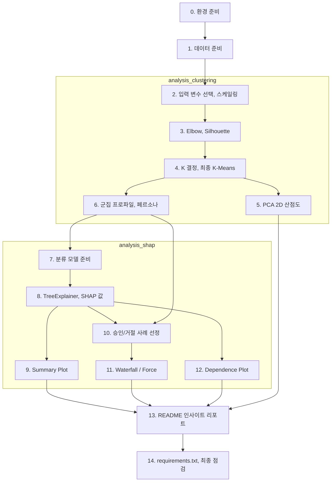

# A5-2 단계별 실습 가이드 — 고객 군집화와 SHAP으로 판정 이유 설명하기

과제 원문: [../subject.md](../subject.md)<br>
개념 설명: [LEARNING_GUIDE.md](LEARNING_GUIDE.md)

이 문서는 환경 준비부터 제출까지 **무엇을 어떤 순서로 만들지** 안내합니다. 완성 코드는 제공하지 않습니다. 각 단계는 목표 / 할 일 / 힌트 / 확인 방법으로 구성되어 있고, 확인 방법(체크포인트)을 통과한 뒤 다음 단계로 넘어가는 것을 권장합니다.

과제 원문의 "Mission 23"은 앞 과제 A5-1을 가리킵니다. A5-1의 `finance_data.csv`와 분류 모델을 이어서 씁니다.

## 전체 흐름

과제는 실행 순서를 **analysis_clustering → analysis_shap → README 정리**로 정해 두었습니다.



## 최종 산출물 체크리스트(과제 원문 기준)

| 산출물 | 근거 |
| --- | --- |
| 군집화: PCA 2차원 산점도(군집별 색), 설명된 분산 비율 표시 | 2-1, 4-2 |
| Elbow Method와 Silhouette Score로 K 선정 | 4-2 |
| 각 군집의 통계적 특징과 페르소나 정의 | 2-1, 2-5, 4-2 |
| SHAP Summary Plot(중요도 + 방향성) **PNG** | 2-2, 4-3 |
| 승인 1건, 거절 1건의 Waterfall Plot PNG(권장) 또는 Force Plot HTML 캡처/저장 | 2-3, 4-3 |
| Dependence Plot(변수 1개 이상) **PNG** + 인사이트 2문장 이상 | 2-4, 4-3 |
| README.md: 군집 정의, 해석 결과, 비즈니스 제언 | 2-5, 4-4 |
| shap, scikit-learn 버전을 명시한 requirements.txt | 7 |

권장 저장소 구조(원문은 구조를 강제하지 않습니다).

```text
A5-2/
├── README.md
├── requirements.txt
├── data_gen.py
├── finance_data.csv               # A5-1과 동일한 데이터
├── analysis_clustering.ipynb      # 또는 .py
├── analysis_shap.ipynb            # 또는 .py
└── images/
    ├── elbow_silhouette.png
    ├── pca_clusters.png
    ├── shap_summary.png
    ├── shap_waterfall_reject.png
    ├── shap_waterfall_approve.png
    └── shap_dependence_<변수>.png
```

## 0단계. 환경 준비

**목표**: 허용 라이브러리만으로 작업 환경을 만든다.

**할 일**

1. Python 3.10 이상인지 확인하고 가상환경을 만든다.
2. 필수: `scikit-learn`, `shap`. 허용: `numpy`, `pandas`, `matplotlib`, `seaborn`. 노트북을 쓰면 Jupyter.
3. 설치 후 shap과 scikit-learn 버전을 기록해 둔다.

**힌트**

- **금지**: XGBoost, LightGBM 등 외부 모델링 라이브러리. 모델은 scikit-learn 내장 모델만 씁니다.
- A5-1에서 imbalanced-learn을 썼더라도 A5-2 허용 목록에는 없습니다. 이 과제에서는 설치하지 않는 편이 안전합니다.
- shap은 numpy, scikit-learn 버전과 궁합이 맞지 않으면 import 오류가 날 수 있습니다. 오류가 나면 세 패키지 버전을 함께 확인하세요.

**확인 방법**: `python -c "import shap, sklearn; print(shap.__version__, sklearn.__version__)"`가 버전을 출력한다.

## 1단계. 데이터 준비

**목표**: A5-1과 **동일한** `finance_data.csv`를 준비한다.

**할 일**

1. A5-1에서 만든 CSV를 복사하거나, 원문 "데이터셋 확보 가이드"의 코드를 `data_gen.py`로 저장해 다시 생성한다(시드가 42로 고정되어 같은 데이터가 나온다).
2. 행 수, 열 이름, 연체 비율이 A5-1 때와 같은지 확인한다.

**힌트**

- 데이터 사용 정책: 스케일링, 결측치 처리, 이상치 제거 같은 전처리는 허용. **임의 컬럼 추가, 외부 데이터 병합, 데이터 증강은 금지**.
- 분석 중 DataFrame에 군집 레이블 열을 붙이는 것은 분석용 메모리상의 작업입니다. 원본 CSV를 덮어쓰지 마세요.
- A5-1처럼 CSV를 `.gitignore`로 제외할지는 A5-2 원문에 규정이 없습니다. 제외한다면 README 실행 방법에 `python data_gen.py`를 넣어 재현 가능하게 하세요(권장).

**확인 방법**: `(10000, 8)`, 연체 비율이 A5-1과 같다.

## 2단계. [analysis_clustering] 입력 변수 선택과 스케일링

**목표**: 타깃을 뺀 6개 입력 변수를 스케일링한다. 개념: [LEARNING_GUIDE 1장](LEARNING_GUIDE.md#1-지도학습과-비지도학습), [2장](LEARNING_GUIDE.md#2-거리와-스케일링)

**할 일**

1. `credit_score`, `is_overdue`를 제외한 특성 목록을 만든다.
2. `StandardScaler`로 변환한 배열 `X_scaled`를 만든다.
3. 원본 단위 DataFrame도 따로 유지한다(6단계 프로파일링용).

**힌트**

- 이상치 제거를 한다면 허용되지만, 기준과 제거 건수를 README에 적어야 합니다(권장). 하지 않아도 됩니다.
- 6개 변수 중 연체 횟수, 카드 수는 정수형이지만 거리 계산에는 숫자로 그대로 써도 됩니다.

**확인 방법**: `X_scaled.mean(axis=0)`이 거의 0, `X_scaled.std(axis=0)`이 거의 1. 열 수는 6.

## 3단계. [analysis_clustering] Elbow와 Silhouette로 K 후보 탐색

**목표**: K=2~10 정도에서 Inertia와 Silhouette Score를 계산하고 그래프로 남긴다. 개념: [LEARNING_GUIDE 3장](LEARNING_GUIDE.md#3-k-means), [4장](LEARNING_GUIDE.md#4-최적의-k-정하기-elbow-method와-silhouette-score)

**할 일**

1. K 범위를 정한다(Silhouette은 K≥2에서만 정의).
2. 각 K마다 `KMeans(n_clusters=k, n_init=..., random_state=42)`를 학습하고 `inertia_`와 `silhouette_score`를 기록한다.
3. 두 그래프(Elbow, Silhouette)를 나란히 그리고 저장한다.

**힌트**

```python
for k in range(2, 11):
    km = KMeans(n_clusters=k, n_init=10, random_state=42).fit(X_scaled)
    # TODO: km.inertia_, silhouette_score(X_scaled, km.labels_, sample_size=..., random_state=42)
```

- `silhouette_score`는 전체 1만 건이면 느릴 수 있습니다. `sample_size`를 지정하면 빨라지며, `random_state`도 함께 고정합니다.
- `n_init`을 명시하지 않으면 scikit-learn 버전에 따라 기본값이 달라 결과나 경고가 달라질 수 있습니다.

**확인 방법**

- Inertia는 K가 커질수록 단조 감소한다.
- 이 데이터는 특성이 서로 독립적으로 생성되어 Silhouette이 0.1대로 낮고 Elbow가 뚜렷하지 않을 수 있다. **정상이다.** 원문 예시(0.42)와 숫자가 달라도 데이터를 바꾸지 않는다. 이유는 [LEARNING_GUIDE 4.4](LEARNING_GUIDE.md#44-이-데이터에서-예상되는-모습) 참고.

## 4단계. [analysis_clustering] K 결정과 최종 K-Means

**목표**: 원문 가이드에 따라 K를 정하고 근거를 글로 남긴다.

**할 일**

1. 원문 우선순위대로 판단한다: **Silhouette 우선 → Elbow 보조 → 페르소나 해석 가능성**.
2. 선정한 K로 최종 KMeans를 학습하고 레이블을 얻는다.
3. 군집별 고객 수를 확인한다.
4. 선정 근거를 3줄 정도로 정리한다(원문 결과 예시의 형식 참고).

**힌트**

- Silhouette 차이가 매우 작다면 "점수 차이가 작아 해석 가능성을 기준으로 K=?를 택했다"처럼 쓰는 것이 원문 가이드에 맞습니다.
- 10단계에서 군집 대표 고객을 고르려면 analysis_shap에서도 군집 레이블이 필요합니다. 방법(권장): (a) 학습된 scaler와 KMeans를 `joblib`으로 저장해 불러오기, (b) 고객 인덱스와 레이블만 담은 별도 파일 저장, (c) 같은 설정과 `random_state`로 다시 학습. 원본 CSV에 열을 추가하는 방식은 피합니다.

**확인 방법**: 노트북을 처음부터 다시 실행해도 군집별 고객 수가 같다. 한 군집에 고객이 극단적으로 몰리지 않았는지(예: 95%) 확인한다.

## 5단계. [analysis_clustering] PCA 2차원 산점도

**목표**: 군집 결과를 PCA 2차원으로 시각화하고 설명된 분산 비율을 표시한다. 개념: [LEARNING_GUIDE 6장](LEARNING_GUIDE.md#6-pca와-explained-variance)

**할 일**

1. `PCA(n_components=2, random_state=42)`를 `X_scaled`에 적용한다.
2. 군집 레이블로 색을 구분한 산점도를 그린다(범례 포함).
3. `explained_variance_ratio_`를 축 이름 또는 제목에 표시한다. 예: `PC1 (17.5%)`, 제목에 `PC1+PC2 = 35.0%`.
4. (권장) 군집 중심도 PCA로 변환해 표시하고, `pca.components_`로 각 PC의 로딩 상위 변수를 확인한다.
5. PNG로 저장한다.

**힌트**

- 점이 1만 개라 겹치면 `alpha`, `s`(점 크기)를 줄이세요.
- 군집은 6차원 `X_scaled`로 만들고, PCA는 그림용입니다. PCA 결과로 다시 군집화하지 않습니다(권장).
- 축 이름에 "소득", "부채" 같은 원래 변수 이름을 붙이지 마세요. PC는 원래 변수가 아닙니다.

**확인 방법**

- 그림 안에서 설명된 분산 비율 숫자가 보인다.
- 이 데이터에서 PC1, PC2는 각각 17% 안팎, 합계 35% 안팎이 예상된다. 군집이 겹쳐 보여도 이상한 것이 아니며, 그 이유(2차원이 정보의 약 1/3만 담음)를 해석 문장에 쓴다.

## 6단계. [analysis_clustering] 군집 프로파일과 페르소나

**목표**: 군집별 통계적 특징을 원래 단위로 정리하고 페르소나를 정의한다. 개념: [LEARNING_GUIDE 5장](LEARNING_GUIDE.md#5-군집-프로파일링과-페르소나)

**할 일**

1. 원본 단위 DataFrame에 레이블을 붙여 `groupby`로 군집별 평균(또는 중앙값)과 고객 수를 구한다.
2. 전체 평균 대비 비율이나 차이를 계산해 두드러진 특징을 찾는다.
3. 군집마다 이름 + 3줄 설명(특징 / 행동 패턴 / 추천 전략 방향)을 쓴다.
4. (권장) 군집별 연체율을 사후 해석용으로 계산한다. 군집 형성에는 쓰지 않았다는 점을 README에 밝힌다.

**힌트**

- 표준화된 값으로 평균을 내면 사람이 읽을 수 없습니다. 반드시 원래 단위로.
- 히트맵(seaborn)이나 군집별 막대그래프로 "전체 대비 차이"를 보여 주면 비기술자도 이해하기 쉽습니다(권장).
- 페르소나 이름은 숫자에 근거해야 합니다. "VIP"라고 부르려면 소득이 실제로 높아야 합니다.

**확인 방법**: README에 들어갈 군집 요약표(군집, 고객 수, 주요 변수 평균, 페르소나 이름)가 완성되었다. 각 페르소나 설명의 모든 주장에 표의 숫자가 대응한다.

**여기까지가 analysis_clustering입니다.** 노트북을 커널 재시작 후 처음부터 실행해 끝까지 도는지 확인하세요.

## 7단계. [analysis_shap] 분류 모델 준비

**목표**: SHAP을 적용할 scikit-learn 트리 분류 모델을 준비한다. 개념: [LEARNING_GUIDE 9장](LEARNING_GUIDE.md#9-shap-라이브러리와-treeexplainer)

**할 일**

1. A5-1의 분류 모델(Random Forest 등)을 어떻게 가져올지 정한다.
   - (a) A5-1에서 저장한 모델 파일을 불러온다.
   - (b) A5-1에서 찾은 최적 하이퍼파라미터로 같은 분할(8:2, `stratify`, `random_state=42`)에서 다시 학습한다.
2. 입력은 타깃을 제외한 6개 특성이다.
3. Test Set 성능(AUC 등)을 한 번 출력해 A5-1과 비슷한지 확인한다.

**힌트**

- 모델이 XGBoost거나 imbalanced-learn Pipeline 안에 있으면 A5-2 제약상 그대로 쓸 수 없습니다. (b) 방식으로 `RandomForestClassifier`를 다시 학습하세요. 불균형 처리가 필요하면 `class_weight="balanced"`.
- 모델 파일을 불러올 때는 저장 당시와 scikit-learn 버전이 같아야 안전합니다.
- 트리는 스케일링 영향을 받지 않으므로, SHAP 그래프를 원래 단위로 읽고 싶다면 원본 6개 특성으로 학습하는 방법이 편합니다(권장). Pipeline을 그대로 쓴다면 TreeExplainer에는 마지막 트리 모델만, 데이터는 전처리된 값을 넘겨야 합니다.
- 어느 방식을 택했는지 README에 적습니다.

**확인 방법**: `type(model)`이 scikit-learn 트리 기반 분류기이고, `model.predict_proba(X_test)[:, 1]`이 0~1 확률을 출력한다.

## 8단계. [analysis_shap] TreeExplainer로 SHAP 값 계산

**목표**: 샘플 1,000~2,000건에 대해 클래스 1(연체) 기준 SHAP 값을 얻는다.

**할 일**

1. 해석용 표본을 고정한다. 예: Test Set에서 `random_state=42`로 1,000~2,000건(원문 권장 범위).
2. `shap.TreeExplainer(model)`을 만든다. **KernelExplainer는 쓰지 않는다.**
3. SHAP 값을 계산하고 **모양(shape)을 출력**한다.
4. 클래스 1(연체)에 해당하는 SHAP 값과 기준값을 꺼낸다.
5. 가법성을 검산한다: 기준값 + SHAP 합 ≈ `predict_proba(...)[:, 1]`.

**힌트**

```python
explainer = shap.TreeExplainer(model)
sv = explainer(X_sample)          # Explanation 객체
print(sv.shape)                   # (샘플, 변수) 또는 (샘플, 변수, 2)
# TODO: 3차원이면 클래스 1 선택 → sv[:, :, 1]
```

- `explainer.shap_values(X)`를 쓰는 경우, shap 버전에 따라 리스트 `[클래스0, 클래스1]`이거나 3차원 배열입니다. `explainer.expected_value`도 클래스별 값 2개일 수 있습니다.
- `class_weight="balanced"`로 학습했다면 기준값이 실제 연체율(약 12%)보다 높게 나올 수 있습니다. 가중치 효과이며 오류가 아닙니다.

**확인 방법**: 몇 명을 골라 `기준값 + SHAP 합`과 `predict_proba`의 연체 확률을 나란히 출력했을 때 소수점 셋째 자리 정도까지 일치한다.

## 9단계. [analysis_shap] Summary Plot — Global

**목표**: 전체 변수 중요도와 방향성을 보여 주는 Summary Plot을 PNG로 저장한다. 개념: [LEARNING_GUIDE 10.1](LEARNING_GUIDE.md#101-summary-plotbeeswarm--global)

**할 일**

1. 클래스 1 기준 SHAP 값으로 Beeswarm 형태의 Summary Plot을 그린다.
2. `show=False`로 그린 뒤 `plt.savefig(...)`로 PNG를 저장한다.
3. 상위 3개 변수의 방향과 의미를 한 줄씩 메모한다(README "Global SHAP 해석" 재료).

**힌트**

- `shap.summary_plot(values, X_sample, show=False)` 또는 `shap.plots.beeswarm(explanation, show=False)`.
- 막대 형태(`plot_type="bar"`)만으로는 방향성이 없어 요구사항을 채우지 못합니다. 막대는 보조로만.
- 저장 전에 `plt.tight_layout()` 또는 `bbox_inches="tight"`를 쓰면 라벨 잘림이 줄어듭니다.

**확인 방법**

- PNG 파일이 열리고 변수 이름, 색 막대(Feature value High/Low)가 보인다.
- 상위 변수가 생성 코드상 연체와 관련된 변수(`overdue_count_6m`, `annual_income`, `debt_ratio`)인지 확인한다. 관련 없는 변수(`age`, `spending_score`, `credit_card_count`)는 SHAP 폭이 좁게 나오는 것이 자연스럽다.

## 10단계. [analysis_shap] 승인/거절 사례 선정

**목표**: 원문 정의에 맞는 거절 1건, 승인 1건을 고르고, 가능하면 군집 페르소나와 연결한다. 개념: [LEARNING_GUIDE 11장](LEARNING_GUIDE.md#11-승인거절-사례-선정과-페르소나-연결)

**할 일**

1. 표본의 연체 확률을 계산한다.
2. 거절 사례: 연체 확률 0.5 이상(원문 "예측 확률이 5 이상"을 0.5로 해석)인 고객.
3. 승인 사례: 연체 확률이 낮은(정상 확률이 높은) 고객.
4. (권장) 4단계에서 남긴 군집 레이블로, 각 사례가 어느 페르소나에 속하는지 표시한다. 군집 중심에 가까운 대표 고객 중에서 고르면 연결이 자연스럽다.
5. 고른 고객의 인덱스, 특성 값, 예측 확률, 군집을 표로 기록한다.

**힌트**

- 군집 중심까지 거리: `kmeans.transform(scaler.transform(X))`. 같은 scaler와 KMeans를 써야 합니다.
- 기준 해석(0.5 등)을 README에 명시하세요.

**확인 방법**: 거절 사례 확률 ≥ 0.5, 승인 사례 확률이 낮음. 두 고객의 특성 값을 보면 직관적으로도 차이가 이해된다.

## 11단계. [analysis_shap] Local Interpretation — Waterfall 또는 Force

**목표**: 두 고객 각각의 예측 근거를 시각화하고 저장한다. 개념: [LEARNING_GUIDE 10.2](LEARNING_GUIDE.md#102-waterfall-plot--local), [10.3](LEARNING_GUIDE.md#103-force-plot--local)

**할 일**

1. 거절 사례, 승인 사례 각각 Waterfall Plot을 그려 PNG로 저장한다(권장 형식).
2. 또는 Force Plot을 HTML로 저장하거나 캡처한다.
3. 각 그래프에서 예측을 가장 크게 올린/내린 변수 2~3개와 크기를 기록한다.

**힌트**

- `shap.plots.waterfall(sv_class1[i], show=False)` 후 `plt.savefig(...)`. 3차원 Explanation에서 클래스를 고르지 않으면 오류가 납니다.
- Force Plot: Jupyter에서 `shap.initjs()` 후 렌더링. 파일로는 `shap.save_html("force_reject.html", plot)`. 렌더링이 안 되면 Waterfall로 대체(원문 트러블슈팅 가이드).
- Waterfall의 `E[f(X)]`는 기준값, `f(x)`는 그 고객의 연체 확률입니다.

**확인 방법**: 그래프 위쪽 `f(x)` 값이 10단계에서 기록한 예측 확률과 같다. "기준값 → 변수별 기여 → 최종값" 흐름을 말로 설명할 수 있다.

## 12단계. [analysis_shap] Dependence Plot

**목표**: 특정 변수의 값 변화에 따른 SHAP 값 추이를 보여 주고 인사이트를 쓴다. 개념: [LEARNING_GUIDE 10.4](LEARNING_GUIDE.md#104-dependence-plot--global한-변수-집중)

**할 일**

1. 변수를 고른다. 원문 기준: **Summary Plot 상위 변수 1~2개 + 비즈니스 의미가 큰 변수 1개**.
2. 각 변수의 Dependence Plot을 그려 PNG로 저장한다(최소 1개 이상 필수).
3. 그래프마다 인사이트를 **2문장 이상** 쓴다(관찰 → 의미 → 행동).

**힌트**

- `shap.dependence_plot("변수명", values, X_sample, show=False)` 또는 `shap.plots.scatter(explanation[:, "변수명"], color=explanation, show=False)`.
- 색은 자동으로 상호작용이 큰 변수가 선택됩니다. 색이 무엇인지 범례(오른쪽 색 막대 이름)를 확인하고 해석에 활용하세요.
- 정수형 변수(연체 횟수 등)는 점이 세로줄로 겹칩니다. 그대로 해석해도 됩니다.

**확인 방법**: 그래프마다 "어느 구간에서 SHAP 값이 양수/음수로 바뀌는가"를 숫자로 말할 수 있다.

**여기까지가 analysis_shap입니다.** 커널 재시작 후 처음부터 실행해 모든 PNG가 다시 만들어지는지 확인하세요.

## 13단계. README.md 인사이트 리포트

**목표**: 그래프와 비즈니스 해석이 함께 있는 리포트를 쓴다. 개념: [LEARNING_GUIDE 12장](LEARNING_GUIDE.md#12-비기술자에게-전달하기)

**할 일**: 원문 권장 템플릿 순서로 작성한다.

| 섹션 | 채울 내용 | 근거 산출물 |
| --- | --- | --- |
| 문제/목표 | 한 문단 | - |
| 군집 요약 | 표 1개 + K 선정 근거 + PCA 그림과 설명력 | 3~6단계 |
| 페르소나 정의 | 군집별 3줄 | 6단계 |
| Global SHAP 해석 | 상위 3 변수의 방향/해석 + Summary Plot | 9단계 |
| Local 사례 2건 | 승인/거절 각각 Waterfall(또는 Force) + 이유 + 소속 페르소나 | 10~11단계 |
| Dependence 인사이트 | 변수별 2문장 이상 | 12단계 |
| 실행 제언 | 군집별 대상 / 메시지 / 액션, 리스크 관리 방안 | 6, 9~12단계 |
| 한계/추가 실험 | 낮은 Silhouette, PCA 설명력, SHAP은 인과가 아님, 합성 데이터 등 | 전체 |

**힌트**

- 그래프 아래에 반드시 해석 문장을 둡니다. 그래프만 있는 섹션이 없어야 합니다.
- 영업팀이 읽는다고 가정하고 "SHAP 값 +0.35" 대신 "연체 위험을 약 35%p 높임"처럼 씁니다.
- 실행 방법(설치 → 데이터 생성 → analysis_clustering → analysis_shap)도 적어 두면 재현에 도움이 됩니다(권장).

**확인 방법**: README만 읽고 "고객 유형이 몇 개이고, 모델이 무엇을 보고 거절하며, 각 유형에 무엇을 해야 하는가"에 답할 수 있다.

## 14단계. requirements.txt와 최종 점검

**할 일**

1. `requirements.txt`에 shap과 scikit-learn **버전을 명시**한다(원문 필수). 사용한 다른 라이브러리도 적는다.
2. 새 가상환경에서 설치 → 데이터 생성 → analysis_clustering → analysis_shap 순서로 끝까지 실행해 본다(권장).
3. 아래 자기 점검표를 확인한다.

## 자주 막히는 지점

| 증상 | 원인 | 해결 |
| --- | --- | --- |
| 군집이 소득 구간으로만 나뉨 | 스케일링 누락 | `StandardScaler` 적용 후 KMeans |
| 군집에 연체자만 모인 군집이 생김 | 타깃 열을 입력에 포함 | 6개 특성만 사용 |
| Silhouette이 0.1대, Elbow 불분명 | 특성이 독립적으로 생성된 데이터 특성 | 정상. 해석 가능성 기준을 더하고 한계에 기록 |
| waterfall에서 차원 관련 오류 | 클래스 축을 고르지 않은 3차원 Explanation | `sv[:, :, 1]`로 클래스 1 선택 |
| Summary Plot이 클래스별 막대로만 나옴 | 리스트(클래스 2개)를 통째로 넘김 | 클래스 1 배열만 넘김 |
| 저장한 PNG가 빈 이미지 | `show=True`로 이미 그림이 닫힘 | `show=False` 후 `savefig` |
| Force Plot이 안 보임 | `initjs()` 누락 또는 Jupyter 외 환경 | `initjs()`, `matplotlib=True`, 또는 Waterfall로 대체 |
| SHAP 계산이 매우 느림 | 1만 건 전체 또는 KernelExplainer | 1,000~2,000건 샘플, TreeExplainer |
| 기준값이 0.12가 아님 | `class_weight="balanced"` 효과 | 정상. README에 설명 |
| 모델 파일 로드 오류 | scikit-learn 버전 차이, imblearn/XGBoost 객체 | 같은 설정으로 RandomForest 재학습 |

## 최종 자기 점검표

| 요구사항(subject.md) | 어디서 확인하는지 |
| --- | --- |
| Mission 23(A5-1)과 동일한 `finance_data.csv` 사용 | 1단계 행 수, 연체 비율 비교 |
| 군집화에 타깃 변수 제외 | analysis_clustering의 특성 목록 |
| 임의 컬럼 추가, 외부 데이터 병합, 데이터 증강 없음 | 코드 전체, CSV 미수정 |
| K-Means 전 스케일링 | `StandardScaler` 적용 셀 |
| Elbow Method와 Silhouette Score로 K 선정 | Elbow/Silhouette 그래프, K 선정 근거 문장 |
| Silhouette 우선, Elbow 보조, 해석 가능성 고려 | README의 K 선정 근거 |
| PCA 2차원 산점도, 군집별 색 | `pca_clusters.png` |
| Explained Variance Ratio 표시 | 산점도 축 이름 또는 제목 |
| 군집별 통계적 특징과 페르소나 | README 군집 요약표, 페르소나 3줄 |
| Tree 기반 모델에 shap 적용, TreeExplainer 우선 | analysis_shap의 explainer 생성 코드 |
| Summary Plot(중요도와 방향성) PNG | `shap_summary.png`(Beeswarm 형태) |
| 승인/거절 각 1건 Waterfall PNG 또는 Force HTML | `shap_waterfall_*.png` 또는 HTML/캡처 |
| 승인/거절 선정 기준 준수 | 10단계 표의 예측 확률, README 기준 명시 |
| Dependence Plot 1개 이상 PNG + 인사이트 2문장 이상 | `shap_dependence_*.png`, README |
| Dependence 변수 선택 기준(상위 1~2 + 비즈니스 1) | README의 변수 선택 이유 |
| 그래프마다 비즈니스 해석 텍스트 | README 각 그래프 아래 |
| 군집별 마케팅/리스크 관리 전략 제언 | README 실행 제언 |
| README: 군집 정의, 해석 결과, 비즈니스 제언 | README 목차 |
| Scikit-learn, SHAP 필수 사용 | import 목록 |
| XGBoost, LightGBM 등 미사용 | import 목록, `requirements.txt` |
| shap, scikit-learn 버전 명시 | `requirements.txt` |
| 실행 순서 analysis_clustering → analysis_shap → README | 파일 이름, README 실행 방법 |
| Python 3.10 이상 | `python --version` |

## 보너스 과제(선택) — 힌트만

### 보너스 1. Streamlit 대시보드(`app.py`)

- 원문 요구: `app.py`를 만들어 브라우저에서 고객 정보를 입력하면 확률과 SHAP 설명이 나오게 하고 저장소에 포함한다. (원문 표현은 "이탈 확률"이지만 이 과제 모델의 출력은 연체 확률입니다.)
- 구조 힌트: 모델과 explainer는 앱 시작 시 한 번만 준비하고(`st.cache_resource` 등 캐싱 기능 활용), 입력 위젯 6개 → 1행 DataFrame → `predict_proba` → 해당 1행의 Waterfall을 `st.pyplot`으로 표시.
- 입력 범위는 데이터의 최솟값/최댓값에 맞추면 이상한 입력을 막을 수 있습니다.
- Streamlit은 허용 라이브러리 표에 따로 없으므로 보너스 범위에서만 쓰고 `requirements.txt`에 버전을 적는 것을 권장합니다.
- 확인: `streamlit run app.py` 후 값을 바꾸면 확률과 그래프가 함께 바뀐다.

### 보너스 2. 군집화 알고리즘 비교(DBSCAN 또는 Hierarchical)

- 같은 `X_scaled`를 입력으로 씁니다. 계층적 군집은 1만 건 전체가 무거울 수 있어 표본으로 비교하는 것이 현실적입니다.
- DBSCAN은 `eps`, `min_samples`에 매우 민감합니다. 레이블 `-1`(노이즈)의 비율을 함께 보고하세요.
- 비교 기준(권장): 군집 수, 군집 크기 분포, Silhouette(노이즈 제외 여부 명시), 같은 PCA 축 위의 산점도, 페르소나 해석 가능성.
- 개념은 [LEARNING_GUIDE 13장](LEARNING_GUIDE.md#13-보너스-개념) 참고.
